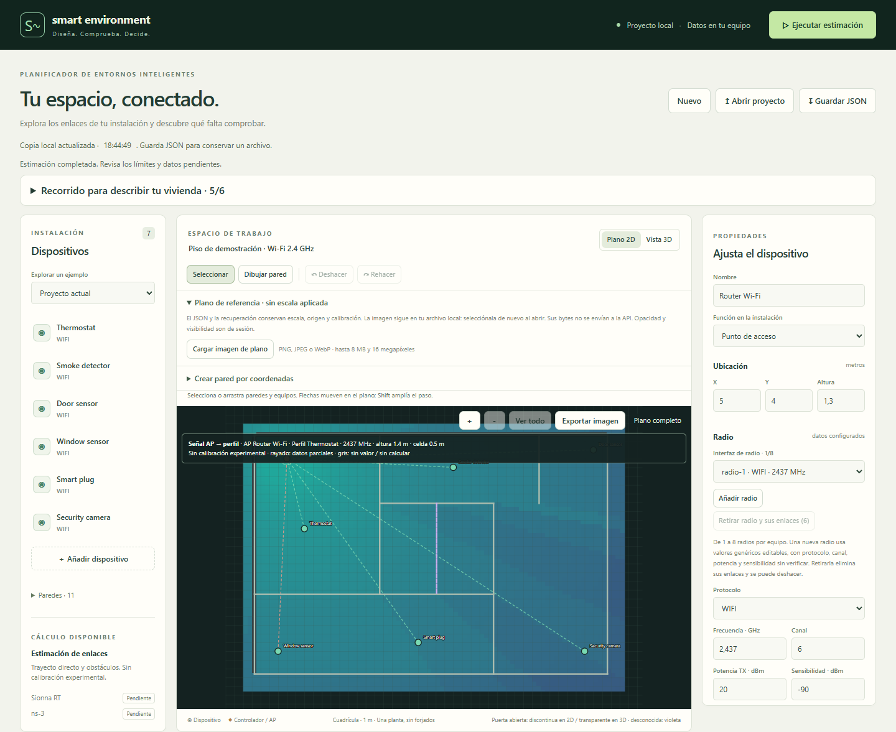
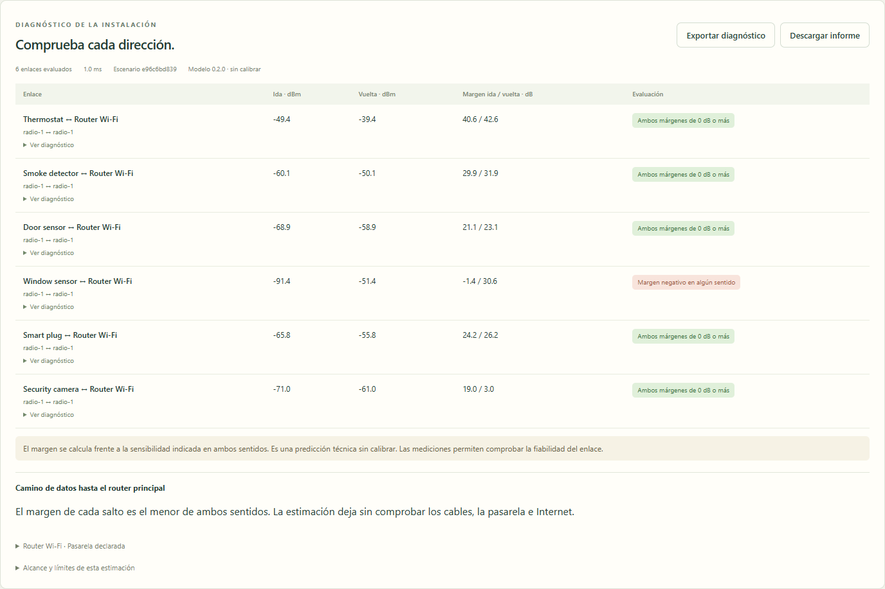
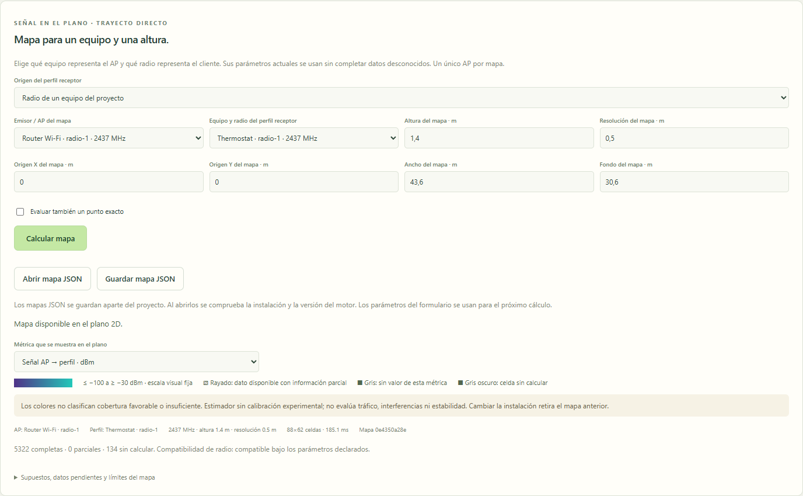
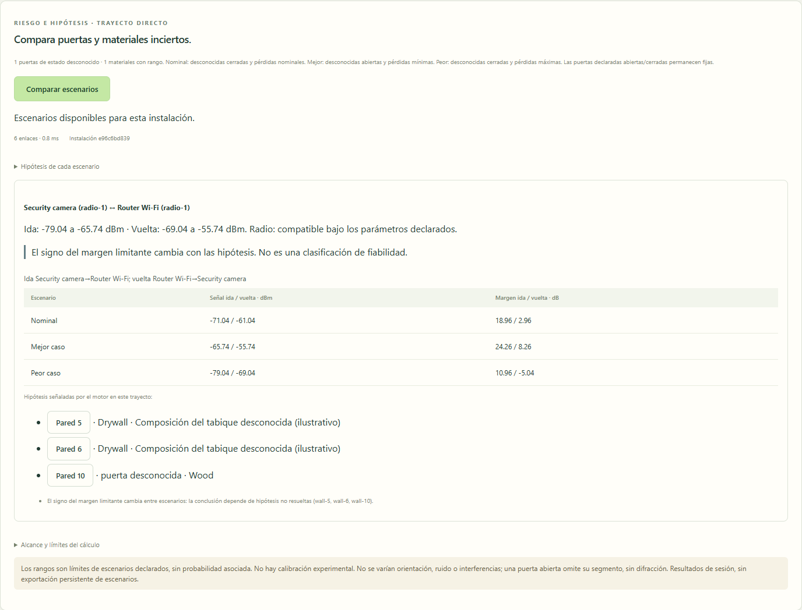
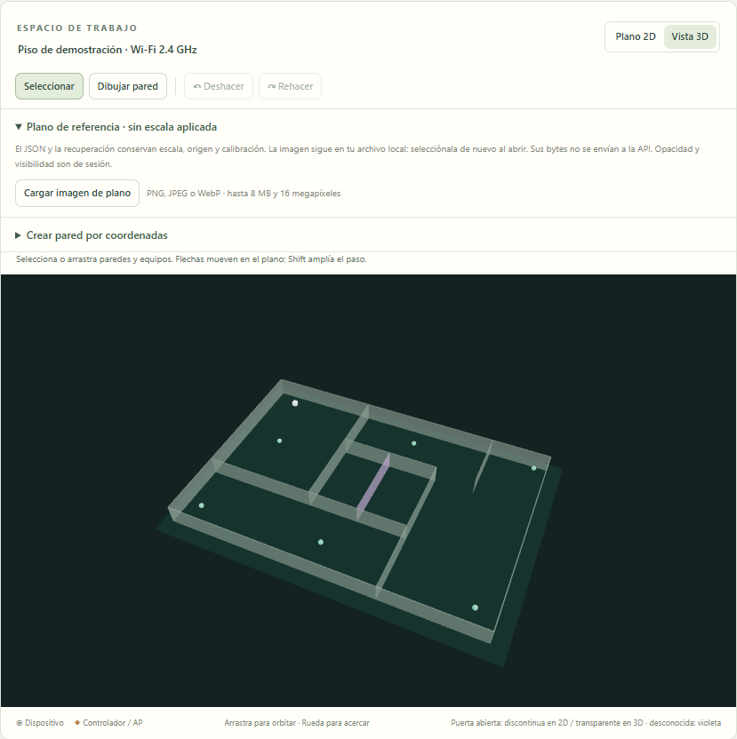
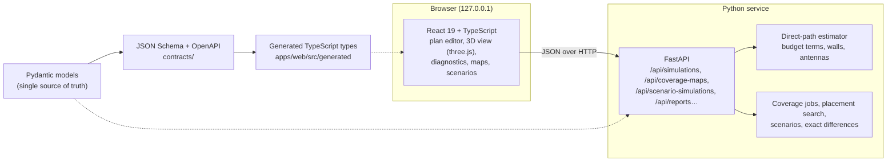

# Smart Home Simulator

[](https://github.com/Phlekies/smart-home-simulator/actions/workflows/ci.yml)


[](LICENSE)

**Check Wi-Fi coverage for smart-home devices before you buy and install them.**
Draw your home, place the router and every planned device, and get a two-way link budget for
each one, a coverage map at the height where it will sit, and a comparison of what changes when
a door is open or a wall's material is unknown. Everything runs locally in your browser.



> **Resumen en español.** Aplicación local para decidir, antes de comprar e instalar domótica, si
> cada equipo tendrá cobertura Wi-Fi 2.4 GHz suficiente en su ubicación prevista y qué cambios
> reducen el riesgo. Calcula ambos sentidos del enlace, mapas de cobertura por altura y escenarios
> con puertas y materiales inciertos. Interfaz React/TypeScript y servicio Python (FastAPI), todo
> en `127.0.0.1`. Es una estimación analítica **sin calibrar**: no garantiza el funcionamiento.
> Para arrancarla basta con Python 3.11+: `python scripts/start.py`.
> [Objetivo del producto](docs/PRODUCT_OBJECTIVE.md) ·
> [estado de la migración](docs/migration/STATUS.md) ·
> [plan tras la migración](docs/product/DEVELOPMENT_PLAN.md).

## Why

A router that reaches a sensor does not mean the sensor reaches the router: battery devices
transmit far weaker than an access point. Most coverage tools show one heatmap of the router's
signal and stop there. This project answers the question a buyer actually has — *"will this
device work here, and if not, what change fixes it?"* — and is explicit about what it does not
know: unknown values stay unknown, and a positive margin is never presented as a guarantee.

## Features

- **Two-way link diagnosis.** Every link is evaluated in both directions with the transmitter
  power, antenna gain and receiver sensitivity of each side. A link only shows *both margins at
  0 dB or more* when both directions reach it; missing sensitivity gives *unverified*, never a
  favourable result. Each row expands into the budget terms: distance, path loss and every wall
  crossed. For access points, the data path to the main router is checked hop by hop.

  

  In the demo, the window sensor hears the router at −51 dBm, but the router hears the sensor's
  −20 dBm transmitter at −91 dBm: the link fails on the way back.

- **Coverage map for one device profile at one height.** Pick the access point and a receiver
  profile (a device of the project or a generic Wi-Fi client) and compute a grid as a background
  job. Cells with partial data are hatched and uncomputed cells stay grey, so a gap is never
  painted as coverage. Maps can be saved and reopened; a saved map checks that it still matches
  the project and the engine version.

  

- **Scenarios for what you do not know.** Doors with an unknown state and materials with a
  declared loss range produce nominal, best and worst cases. The panel names the walls behind
  each hypothesis and flags links whose conclusion flips between scenarios.

  

- **Floor-plan editor.** Walls with materials and thickness, drag and drop, undo/redo, walls by
  coordinates, a scaled reference image of your real plan, zoom and pan, PNG export, a 3D view
  and a guided path for describing a home from scratch.

  

- **Compare and search positions.** Compare the installation before and after moving devices,
  with an explanation of the signal change term by term (distance, walls, antennas), and compare
  the allowed places for an access point, also under the worst-case scenario.
- **Where each value comes from.** Transmit power and sensitivity are labelled as declared,
  measured, standard minimum, inferred or unknown, with their source. Access points declare
  their data connection: the gateway itself, a cable, or a wireless link of the project.
- **Reports and projects.** Prepare an installation report as Markdown or JSON, with the current
  map and the evidence level of each conclusion; projects are plain JSON files. The browser keeps
  a local recovery copy, and the original Java project files still import.
- **Local only.** The service listens on `127.0.0.1`; plans and reports never leave the machine.

## Getting started

Requirements: **Python 3.11 or newer**. Node.js 22 is only needed to build the interface from a
source checkout; the zip attached to each release already contains it.

```bash
git clone https://github.com/Phlekies/smart-home-simulator.git
cd smart-home-simulator
python scripts/start.py
```

`start.py` creates `.venv` in the folder, installs the pinned dependencies, builds the interface
once if needed and serves the app at <http://127.0.0.1:8000/>. Nothing is installed outside the
folder. To try it, open [`docs/images/demo-apartment.shsim.json`](docs/images/demo-apartment.shsim.json)
with **Abrir proyecto**, press **Ejecutar estimación**, then select the router and **Calcular mapa**.
The interface is in Spanish.

## How the estimate works

For each direction of a link the engine adds the terms of a link budget along the direct path:

```
Pr = Pt + Gt(θ) + Gr + Gsys − PL(d) − Σ L_wall − L_pol
margin = Pr − receiver sensitivity
```

| Term | Model |
| --- | --- |
| `PL(d)` | Free space at 1 m plus log-distance with exponent `n` |
| `L_wall` | Penetration loss of each wall crossed, by material, thickness and band (2.4 / 5 GHz) |
| `Gt(θ)` | Omnidirectional, or a `cos^k` main lobe with a side-lobe floor |
| `L_pol` | Polarisation mismatch, capped at 26 dB |

Results carry the engine version and a SHA-256 of the canonical project, so a result computed for
a previous version of the plan is detected as stale. The engine refuses bands it has no material
data for instead of guessing.

## Architecture



| Path | Contents |
| --- | --- |
| [`services/simulator`](services/simulator) | FastAPI service, Pydantic models, engine, coverage maps, scenarios, reports, Java import |
| [`apps/web`](apps/web) | React interface built with Vite; editor logic in `src/editor` with its own tests |
| [`contracts`](contracts) | JSON Schema and OpenAPI generated from the Pydantic models |
| [`scripts`](scripts) | `start.py` (one-command start), `dev.py` (both dev servers), contract export, packaging |
| [`docs`](docs) | Product objective, architecture decisions, simulation contracts and evidence |

## Engineering highlights

- **Contract first.** Pydantic models generate JSON Schema, OpenAPI and the TypeScript types the
  interface uses; CI fails if any generated file drifts. New fields are added as optional so old
  projects keep their hash and stay valid.
- **No silent fallback.** Asking for an engine that is not integrated (Sionna RT) returns HTTP 501
  instead of quietly running the simple estimator.
- **Verified against the original application.** A parity harness extracts the Java sources from
  the `java-desktop-final` tag, compiles them and runs 76 direct-path probes (antenna patterns,
  polarisation, walls at 2.4 and 5.2 GHz) against the Python engine: the largest difference is
  0.0022 dB, explained by a rounded constant in Java. pytest re-checks the stored values without a
  JDK. See [JAVA_PARITY.md](docs/simulation/JAVA_PARITY.md).
- **Advanced engine evaluated, not assumed.** Sionna RT 2.2.0 was run on CPU in WSL2 against 18
  analytical reference cases (|Δ| < 0.001 dB); it is documented as a candidate and stays out of
  the product until real measurements exist to compare both engines
  ([evaluation](docs/simulation/ADVANCED_ENGINE_EVALUATION.md)).
- **Tested on three systems.** 444 Python tests (geometry, budgets, contracts, scenarios, reports,
  API) and 151 interface tests (geometry, history, coverage runner, saved maps, link differences,
  reports), run by CI on Linux, Windows and macOS together with the build and the packaging.

## Development

```bash
python -m venv .venv
.venv/bin/python -m pip install -r services/simulator/requirements-dev.lock.txt   # Windows: .venv\Scripts\python.exe
.venv/bin/python -m pip install --no-deps --no-build-isolation -e services/simulator
npm --prefix apps/web ci

.venv/bin/python scripts/dev.py                        # API on :8000 and Vite on :5174
.venv/bin/python -m pytest services/simulator/tests -q
npm --prefix apps/web test
npm --prefix apps/web run build
.venv/bin/python scripts/export_contracts.py --check   # generated contracts are up to date
```

More detail in [LOCAL_DEVELOPMENT.md](docs/migration/LOCAL_DEVELOPMENT.md) and
[CONTRIBUTING.md](CONTRIBUTING.md).

## Limitations

- Direct path only: no reflections, diffraction, floors or fading. One floor per project.
- Uncalibrated: no measured home has been used yet to fit or validate the model.
- Coverage only: interference, traffic, throughput and application compatibility are not evaluated.
- A positive margin is a technical prediction, not a promise that a device will work.

## Project history

Started in 2025 as a Java/JavaFX desktop simulator of indoor propagation (multipath engine, ray
tracing animation, hub optimiser). In 2026 it was migrated to a local web application with a
Python service, driven by a narrower product goal: decisions before buying smart-home devices.
The migration followed written gates — feature matrix, parity with the Java engine, contracts and
three-OS CI — before Java left `main`. The desktop application remains available in the
[`java-desktop-final`](https://github.com/Phlekies/smart-home-simulator/tree/java-desktop-final)
tag and in [release v1.0.0](https://github.com/Phlekies/smart-home-simulator/releases/tag/v1.0.0).
See the [changelog](CHANGELOG.md) and the [migration status](docs/migration/STATUS.md).

## License

Released under the [MIT License](LICENSE).
